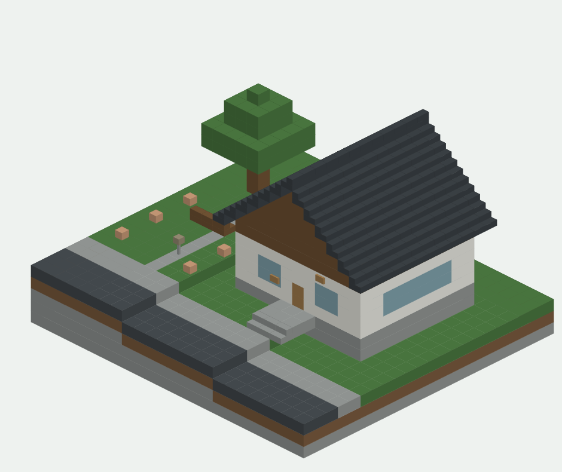

# prayabench

**A visual benchmark for AI building in Minecraft.**

Give models the same plot and brief. Inspect what they build, check whether the
doors are reachable and the fixtures are supported, then reveal who built what.



prayabench is an experimental, MIT-licensed toolkit for comparing generated voxel
builds. It keeps construction validity, brief completion, visual preference and
runtime separate. There is no magic combined score and no authoritative leaderboard.

## Try it without a model or Minecraft server

Python 3.11 or newer; no runtime Python dependencies.

```sh
git clone https://github.com/jeffbai996/praya-bench.git
cd praya-bench
python -m venv .venv
. .venv/bin/activate
python -m pip install .
prayabench demo runs/demo
```

Open `runs/demo/index.html`. Rotate the scenes, inspect upper and ground-floor
cutaways, review automated findings and brief checks, and download your review
notes. The two demo scenes are deterministic package examples, **not model results**.
The HTML works offline and sends nothing anywhere.

## Benchmark tasks

```sh
prayabench tasks
prayabench tasks --json
prayabench init runs/canal --task canal-crossing
```

`init` freezes `prompt.txt`, `palette.txt` and a synthetic `fixture.json`, with
SHA-256 hashes in `manifest.json`. Eight synthetic tasks cover distinct spatial
and architectural constraints:

- **`sloped-cafe`** (`commercial-slope`): one-storey café and pocket garden on an east-rising lateral slope.
- **`small-house`** (`residential-two-storey`): two-storey compact house with interior stairs, headroom and paired bed.
- **`pocket-park`** (`landscape-civic`): continuous park path, conifer and broadleaf trees, benches, planted beds and mounted sign.
- **`shop-renovation`** (`adaptive-reuse`): interior café fit-out inside a protected older shell with a historic `Built 2012` placard.
- **`canal-crossing`** (`spanning-infrastructure`): footbridge spanning a protected stone-lined water canal to reach a south-bank tea kiosk.
- **`corner-shophouse`** (`urban-corner-mixed-use`): two-storey mixed-use building addressing two protected streets, with ground retail and an upstairs apartment.
- **`party-wall-infill`** (`zero-lot-line-infill`): narrow two-storey bookshop and reading loft between two protected neighbour party walls.
- **`hillside-pavilion`** (`steep-terrain-terracing`): stepped retaining route climbing a steep 2D slope (`ground(x, z)`) to a summit pavilion.

Give a model the prompt and supported palette. Have it return the specified
Python `build(put, box, head, sign, ground)` function, or supply declarative JSON
directly. Keep inputs, model settings, budgets and allowed tools identical across
a comparison.

### Compile Python submissions in Docker

```sh
docker pull python:3.12-slim
prayabench compile runs/canal answer.py --out runs/canal/model-a.json
prayabench evaluate runs/canal runs/canal/model-a.json --out runs/canal/model-a.checks.json
```

Generated Python is never executed by the host CLI. The compiler uses a
network-disabled, read-only container with no host mounts, no added privileges,
a non-root user, memory/process limits and CPU/wall-clock limits. It pins the
locally installed image ID in `.sandbox.json` and fails closed if Docker or the
image is unavailable. If a response wraps its code in a single Markdown fence,
the compiler extracts the Python block and records `stripped_markdown_fence: true`.

Submissions exceeding the 14,000-character contract are rejected by default. Pass
`--diagnostic-overbudget` to compile an over-limit submission for visual inspection;
the output is marked `diagnostic_only: true` and flagged `source_budget_exceeded`
during evaluation.

To reproduce the image exactly on another machine, pull the recorded registry
digest yourself and pass it with `--image`. Image IDs are local content identities;
tags such as `python:3.12-slim` can change.

The AST checks are an additional format filter, **not a security sandbox**. The
container shares the host kernel. Keep Docker updated; this alpha is intended
for local experiments, not an unattended public code-execution service.

### Or import JSON without executing code

```json
{"cells": [[5, 3, 8, "stone_bricks", null, "plinth", null]]}
```

Cells are `[x, y, z, block_state, sign_lines?, component?, prop_asset?]`.
Coordinates are integers; later writes replace earlier ones. Prop assets are
semantic placeholders (`coffee_maker`, `pos_terminal`, `mailbox_orange`), not
downloaded Minecraft skins.

### Optional native-client adapters

If you already have an authenticated client installed:

```sh
prayabench generate runs/canal --provider codex --model YOUR_MODEL --effort medium --out runs/canal/attempt-a
prayabench compile runs/canal runs/canal/attempt-a/answer.py --out runs/canal/model-a.json
```

Adapters are included for `codex`, `claude` and the optional `agy` client. There
are no bundled credentials, automatic sign-ins or silent provider fallbacks.
Generation makes a model call using your client's account and may consume paid
usage. Native clients have different system prompts and overhead; compare those
runs as **model-plus-client** measurements.

### Compare and summarize runs

```sh
prayabench compare runs/canal runs/canal/model-a.json runs/canal/model-b.json --out runs/canal/comparison.html
prayabench summary runs/canal/*.checks.json --out runs/canal/summary.json
```

Labels in `compare` are shuffled and hidden behind a reveal control by default.
Use `--named` to show them immediately. `summary` aggregates validity counts and
brief completion ratios across check reports without inventing a single combined score.

## What gets checked

**Construction validity (`issues`):**
- Scene bounds, source-character contract and protected street/canal/neighbour cells.
- Full solid backing for wall signs, wall torches and wall-mounted props; overhead or horizontal bar support for hanging signs.
- Flush support for tabletop props, pots, beds, carpets, standing lights and slender mailbox posts; hinge/floor/ceiling support for trapdoors.
- Soil/grass/moss substrates for planted ground flora, including two-block tall plants.
- Aligned paired door and bed halves, glass-pane door jamb warnings, blind glazing against opaque party walls, and approximate street-to-door reachability (including across bridges and up hillside steps).
- Renovation date honesty when fitting out historic shells.

**Brief completion (`completion`):**
- Task-specific presence and reachability checks: minimum edited volume, reachable ground/south-bank/summit entrances, stair-reachable upper storeys, continuous park paths, dual-street frontage glazing, required semantic props, paired beds, bookshelves, trees, flora, seating and lighting.

## What does not get proved

The evaluator is a deliberately small approximation, not the Minecraft engine,
a structural simulation, an accessibility audit or a complete block-state
registry. Walking checks permit one-block jumps. Passing completion checks proves
requested elements exist, not that rooms are pleasant or well laid out. The
renderer uses original flat colours and approximate geometry; inspect sign records
for text.

One appealing scene does not establish a model ranking. Use multiple tasks and
repeats, report failed runs, keep the evaluator version fixed, and record any
manual adjudications separately. Do not quietly repair model output before scoring.

See [the protocol](docs/protocol.md) and [contributing guide](CONTRIBUTING.md).

## Development

```sh
python -m pip install -e .
python -m unittest discover -s tests -v
docker pull python:3.12-slim
PRAYABENCH_DOCKER_TESTS=1 python -m unittest discover -s tests -p test_sandbox.py -v
```

CI tests the package and Docker compiler without calling any models.

## License and provenance

Code, synthetic fixtures and original flat-colour SVG artwork: [MIT](LICENSE).
No Minecraft textures, saved worlds, third-party head skins or private pilot
transcripts are bundled. Contributions must identify their provenance and
redistribution rights. Minecraft belongs to Mojang/Microsoft; this is an
independent project, not an official Minecraft product.

The name comes from the building project that motivated the experiments.
You do not need its world, lore or infrastructure to run prayabench.
